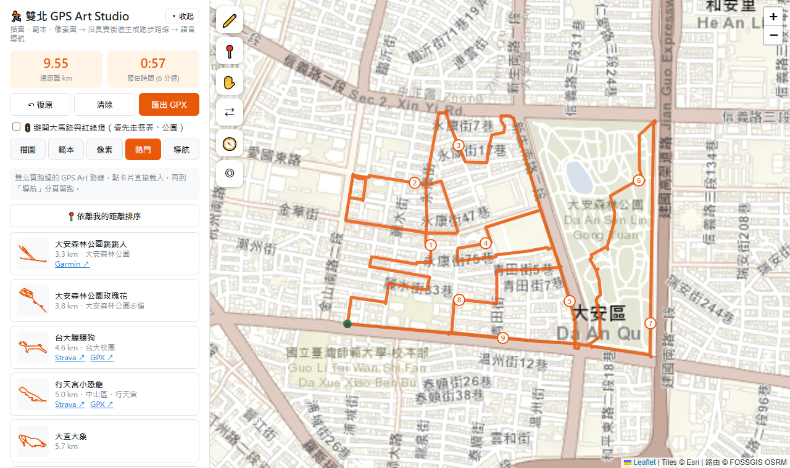
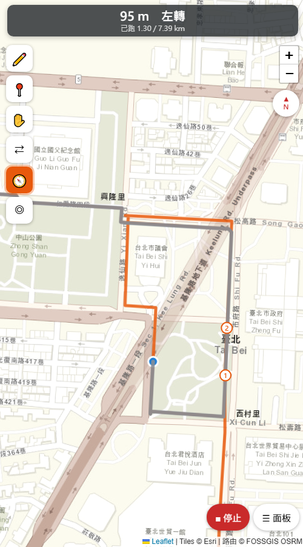
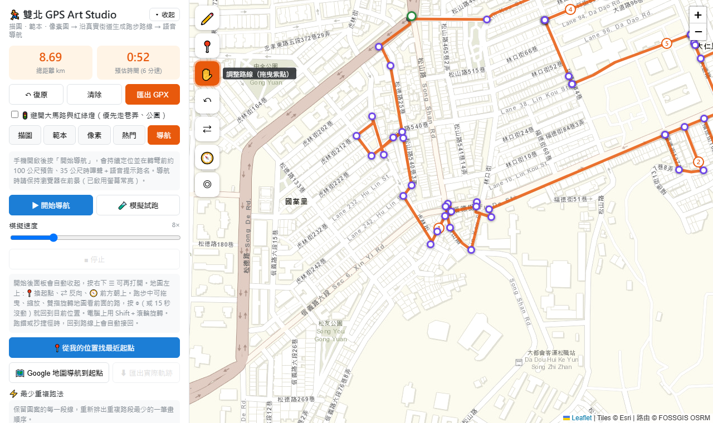

# 🏃 雙北 GPS Art Studio

把一張簡筆畫變成真的跑得出來的城市路線：描圖、套範本或畫像素圖，路線會自動貼合真實街道；跑步時有中文語音導航，跑錯路或抄捷徑都會自動接回。

**👉 線上使用：https://zzzixun.github.io/gps-art/**（手機開啟可直接導航）

單一 HTML 檔，不需要後端，也不需要 API key。

| 熱門路線＋每公里標號 | 跑步導航（手機） |
|---|---|
|  |  |

✋ 調整路線：拖曳紫色控制點，只會重算它前後兩段

## 為什麼做這個

GPS Art 是指用跑步軌跡在地圖上畫出圖案，在 Strava 上很流行。實際去跑時，會遇到三個問題：

1. **畫好的圖不一定跑得出來。** 線條常常斜穿過建築物，得一段一段手動對到街道上。
2. **網路上的路線很難拿到。** 大多藏在 Garmin、Strava 的登入頁後面，或只有一張截圖。
3. **跑的時候會迷路。** GPS Art 路線常常自己交疊、來回折返，一般的地圖導航不適合。

這個工具把「設計 → 貼合街道 → 最佳化 → 導航」整合在同一個網頁裡完成。

## 功能

| 功能 | 說明 |
|---|---|
| 描圖 | 上傳圖片或截圖當描圖紙，用「兩點對齊」疊到地圖上的正確位置，再沿著線條點控制點，路線會自動沿街道接起來（免費的 JPG 轉 GPX） |
| 範本 | 27 種圖案：愛心、星星、臘腸狗、魚、房子、箭頭、四葉草、小鬼、貓咪、笑臉、熊、兔子、月亮、閃電、雲、蘋果、聖誕樹，以及整隻的坐著的貓、兔子、小鴨、大象、鯨魚、蝸牛、烏龜、企鵝、鹿、章魚（有眼睛、殼紋等細節）；可以讓程式在畫面中**自動找最貼合街道的位置** |
| 指定範圍自動生成 | 點一個地點（或用目前位置）、選半徑和圖案，程式在範圍內自動找出最像的三條路線，點一下就套用。預設「不管距離，只求最像」（圖案大小也自動找），也可以指定想跑的距離 |
| 手繪畫板 | 在畫板上一筆一筆畫（外框、眼睛、嘴巴…），有橡皮擦和多步復原；自動生成會把每一筆都沿街道描出來，再接成一條重複最少的路線 |
| 像素 | 在 8×8 格子上畫像素圖，程式依街道角度與街區大小展開成方格路線 |
| 熱門 | 17 條雙北實跑路線，點一下就載入，可依離我的距離排序；另有 25 個內建圖案在全大台北最像的前 3 個位置（[city-shapes](https://github.com/zzzixun/city-shapes) 掃描 132 個地點的結果） |
| 調整路線 | 拖曳控制點只重算它前後兩段；點路線可以加點，點控制點可以刪除，也能復原 |
| 最少重複跑法 | 圖案的每段線都保留，重新排出重複路段最少的跑法，並用每公里標號顯示跑的順序 |
| 智慧重排 | 跑步時記錄圖案哪些地方真的跑過；繞路、反方向或跳到別段時，從你目前的位置和方向，重新把還沒跑的部分排成最短的一筆畫（一圈的路線你往哪邊跑就順著哪邊排） |
| 避開大馬路 | 優先走巷弄和公園，少過有紅綠燈的路口，並顯示路線經過幾個號誌路口 |
| 導航 | 語音提示轉彎與路名、地圖跟著前進方向轉、真正跑過的路段才變灰（繞路跳過的維持橘色，結束時告訴你漏了多少）、偏離路線警告、加速模擬試跑、匯出實際軌跡 |

另外還有：自訂起點、反向跑、從我的位置找最近的起點、用 Google 地圖導航到起點、匯出 GPX（可匯入 Strava、Garmin）。

## 遇到的問題與解法

| 問題 | 解法 |
|---|---|
| GPS Art 路線會交疊，同一個路口可能經過好幾次，GPS 一投影到路線上就跳到別段 | 只在「目前進度往回 30 m 到往前 150 m」這段範圍找位置。偏離路線時才搜尋後面的路段，如果貼近 25 m 內，就當作抄捷徑並自動接回 |
| 圖案每條線都要跑到，照原本的順序跑會重複很多路段 | 這其實是**中國郵差問題**：先把路線轉成圖，把奇數度的節點兩兩配對（貪婪配對加上兩兩交換改良），再用 Hierholzer 演算法排成一筆畫，路口優先直走。熱門路線實測最多省 0.8 km，每條都在 0.3 秒內算完 |
| 範本放在哪裡最好跑，只能憑感覺試 | 把路網轉成 10 m 解析度的「離最近道路距離」查表，再把圖案以「位置 × 24 種角度 × 3 種大小」試過數萬種擺法，前 30 名局部微調後，取平均離道路最近的前三名 |
| 公用路由伺服器沒辦法設定「避開大馬路」 | 從 OpenStreetMap 下載畫面內的路網和紅綠燈，在瀏覽器裡自己寫 A* 路由：主幹道成本 ×2–4、貼著大馬路的人行道也算大馬路、進入號誌路口加罰 80 m。實測號誌路口減少 30–40%，距離只多 0–9% |
| 路線走在人行道上，GPS 稍微偏到對面，就被當成「左轉再右轉」，像在叫人過馬路 | 40 m 內出現方向相反、轉完方向幾乎不變的兩個轉彎，就視為換到對面人行道，兩個提示一起拿掉。熱門路線的轉彎指示平均少了約 15% |
| 匯入的 GPX 沒有轉彎資訊；簡化封閉路線時，因為起終點重合，會整條縮成 2 個點 | 自己用 Douglas-Peucker 簡化路線，再算方位角變化來偵測轉彎；起終點重合時改用「到端點的距離」判斷。路名用 OSRM 的 nearest 服務查詢 |
| 「找最像的位置」只看圖案離路多遠，台北巷子密，放哪裡分數都差不多；沿街道生成後還可能繞路、折返 | 參考 [Waschk & Krüger 2019](https://link.springer.com/content/pdf/10.1007/s41095-019-0146-z.pdf)：前 8 個擺法都**實際找路**，A* 的路段成本 = 長度 ×（1 + min((離圖案距離 / 25 m)², 30)），讓路線貼著圖案走；再用雙向距離（漏畫、亂繞）、尖角保留率、來回重跑長度評分。圖案大小由想跑的距離反推。方法先在 [city-shapes](https://github.com/zzzixun/city-shapes) 用 Python 做實驗驗證 |
| 熱門路線看起來完整，是因為有眼睛、嘴巴這些內部線條，只畫一圈外框像剪影 | 手繪畫板支援多筆畫：每一筆各自沿街道描（封閉的筆畫走一圈、開放的走一條線），從最長的一筆開始依序接到最近的下一筆，連接段在已畫過的街道上成本 ×0.3，最後交給「最少重複跑法」重排成一筆畫 |
| 公用的 Overpass 伺服器常常忙碌或故障（實測主站回 502、備援站 90 秒沒回應），自動生成一次要下載約 9 MB 路網 | 雙北的路網預先打包：用 pyosmium 讀 Geofabrik 的台灣 OSM 檔，篩選條件和 Overpass 查詢相同，切成 0.02° 的小塊；長的道路只存經過該塊的路段、座標存相對值，從 52 MB 縮到 29 MB。網頁在雙北直接讀這些檔案（約 1 秒），範圍外才用 Overpass，並改成分塊下載＋IndexedDB 快取＋逾時重試，4 個伺服器輪流使用 |
| 自動生成的路線距離常和想跑的不一樣（繞路、連接段多寡因地而異） | 第一輪找完後，用實際的「路線長 ÷ 圖寬」校正圖案大小再找第二輪；距離偏差超過 10% 扣分，清單顯示比目標多或少幾公里 |
| 多筆畫的連接段會在圖上多出突兀的直線（例如從臉的外框直接切到眼睛） | 連接段改成：沿已經畫過的街道折返幾乎免費（×0.2，重複跑沒關係）、沿圖案線條走成本正常、離開圖案越遠越貴（最多 ×31），並從「已畫好的任何位置」找最近的下一筆，只在最短的地方搭橋。實測 3 個地點 × 8 種圖案，圖案外多出來的線少了 25%（29.5 → 22.0 km），分數持平或更好 |
| 「只求最像」要試 3 種大小、實際找路 24 次，一個圖案要好幾秒 | 用效能分析找出最花時間的地方：評分和找路都在反覆算「點到折線的距離」，改用格子索引只查附近的線段，找路時超過成本封頂的 280 m 就不再往外找；A* 改用重複使用的數字陣列取代 Map。候選數量不變，結果完全相同（30/30），速度快約 1.5 倍。（試過減少候選，快 1.7 倍但平均分數從 1.45 變差到 2.01，所以不採用） |
| 指定距離時，圖案大小被距離綁死，就算大一點或小一點會更像也不會去試 | 新增「只求最像」模式（預設）：從範圍放得下的最大尺寸往下試 3 種大小，只依像不像排名。實測 3 個地點 × 6 種動物，18 組裡 15 組比固定 10 km 更像，路線約 10–16 km |
| 在電腦上直接開 HTML 檔時，OpenStreetMap 圖磚回傳 403 封鎖圖片，但不會觸發錯誤事件，程式察覺不到 | 偵測到是本機開檔時，改用 Esri 圖磚；放到 GitHub Pages 後才用 OSM 圖磚 |
| 實際跑的時候常常不照順序：一圈的路線想反方向跑、折返段想繞到下一個路口再回來、中間想先跑別段 | 改成記錄「圖案哪些地方跑過」而不是「跑到第幾公尺」。偏離後回到圖案上、或在路線上反方向跑時，就把還沒跑的部分當成**鄉村郵差問題**：先用最短路把各塊沒跑的地方和你的位置連成一塊，再配對奇數度節點，最後用 Hierholzer 從你的位置排一筆畫，第一步選和你前進方向最一致的路。模擬測試：反方向起跑、中途跳段、從中間開始，最後都只漏 0–50 m |
| 跑步中想縮小看前面的路線，但地圖每秒都被拉回自己的位置 | 使用者拖曳或旋轉地圖時暫停跟隨，按 ◎ 或 15 秒後自動回來。程式自己轉地圖時加旗標，分辨是程式轉的還是使用者轉的 |

## 技術

- **前端**：原生 JavaScript、Leaflet 1.9、leaflet-rotate（地圖旋轉）
- **路由**：FOSSGIS OSRM 步行伺服器（OSRM 官方的 demo 伺服器只有開車模式）；選了避開大馬路時，改用瀏覽器裡自己寫的 A*
- **路網資料**：雙北、鹿港範圍讀預先打包的 `net/`（`build_net.py` 從 Geofabrik 的台灣 OSM 檔切成 906 塊，共 30 MB、gzip 後約 12 MB；範圍是雙北和鹿港）；範圍外才用 OpenStreetMap Overpass API，分塊下載並存在瀏覽器 IndexedDB
- **瀏覽器 API**：Geolocation、Web Speech（中文語音）、Screen Wake Lock（螢幕常亮）、Web Audio（嗶聲）、Vibration（震動）
- **資料處理**：`build_routes.py` 把 GPX、KML 簡化後打包成 `routes.js`，點數約減少 70%

## 使用

- 手機：開啟 https://zzzixun.github.io/gps-art/ 並允許定位。定位需要 HTTPS，所以要從這個網址開。
- 電腦：直接用瀏覽器開啟 `index.html`。
- 新增熱門路線：把 GPX 或 KML 放進 `routes/`，執行 `python build_routes.py`。
- 更新演算法推薦：在 city-shapes 跑完掃描後執行 `python build_recommended.py ../06-city-shapes/out/scan/best.json`，產生 `recommended.js`。
- 更新雙北路網：下載 [taiwan-latest.osm.pbf](https://download.geofabrik.de/asia/taiwan-latest.osm.pbf) 到 `cache/`，`pip install osmium` 後執行 `python build_net.py`。

## 已知限制與下一步

- 網頁一關螢幕或切到背景就無法定位，這是瀏覽器的限制。下一步打算用 Capacitor 包成 Android App，加上背景定位。
- 公用路由伺服器有流量限制，請勿大量自動呼叫。
- 自動生成的範圍最大半徑 2 km。實驗顯示圖寬 2–3 km（跑 8–13 km）最像，再大幫助不大。
- 手繪多筆畫時，筆畫之間的連接段也要跑，會在圖上多出幾條線（程式會優先走已經畫過的街道來減少）。

## 資料來源

熱門路線來自 [GRASS 台北實測路線](https://grass.camp/blog/strava-art-gps-running-route-guide-taiwan)、Garmin Connect、運動筆記、Strava、Google 我的地圖，版權屬原作者；原始 GPX 不放在 repo 中。地圖 © OpenStreetMap contributors、Esri。

## 授權

© 2026 尤梓薰（Yu Tzu-Hsun）。本專案以 [GNU GPL v3.0](LICENSE) 授權釋出：歡迎使用、學習與修改，但若對外發布修改後的版本，必須同樣以 GPL v3.0 開放完整原始碼，並保留原作者署名。

熱門路線（`routes.js`、`routes/`）的版權屬於各原作者，不在此授權範圍內。第三方套件依各自授權：Leaflet（BSD-2-Clause）、leaflet-rotate（GPL-3.0）。
